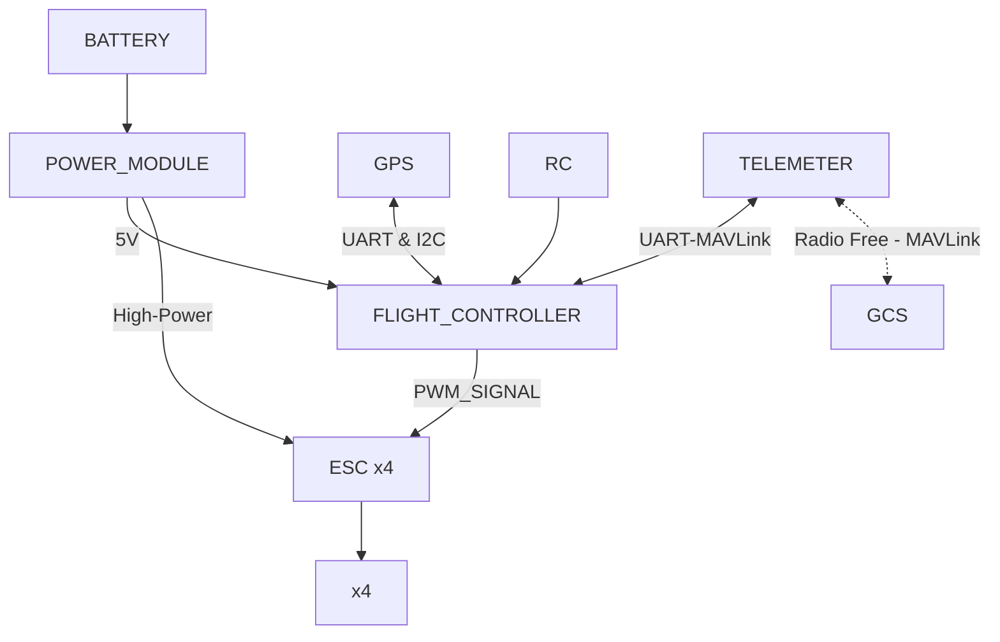
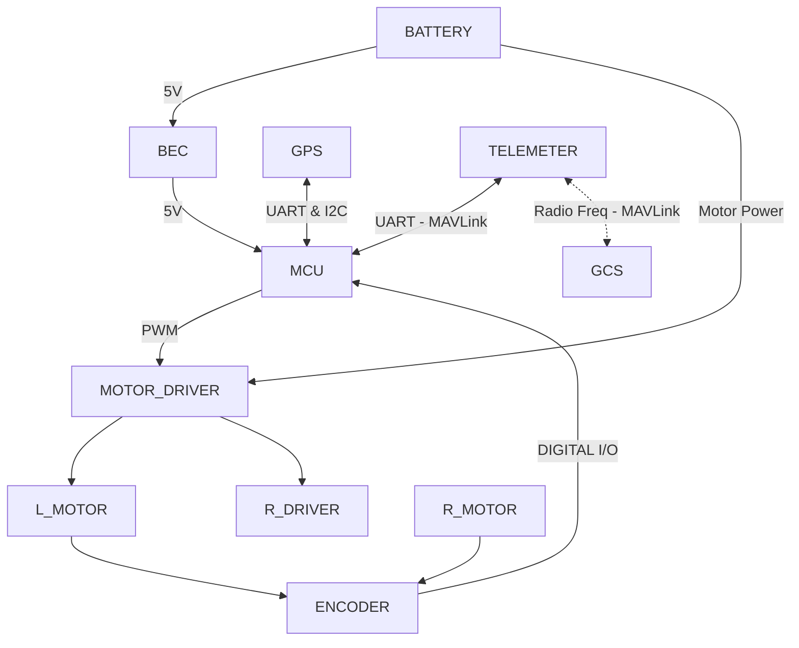

# İHA ve İKA Entegrasyonu - Heterojen Sürü Koordinasyonu

## 1. Proje Mimarisi
* '/docs': Donanım bileşen listeleri, bağlantı şemaları ve değerlendirme raporu.
* 'params': ArduCopter ve ArduRover için yapılandırılmış paramtere dosyaları.
* '/src': MAVLink protokolü üzerinden haberleşen C tabanlı koordinatör yazılımı.
* '/simulation': ArduPilot SITL simülasyon ortamı yapılandırmaları ve test notları.

## 2. Donanım Bileşenleri ve Bağlantı Şemaları
* UAV - GRAPH

* UGV - GRAPH

## 3. Kurulum ve Çalıştırma Adımları 
1. **Simulasyonun başlatılması:** ...
2. **Koordinatör Yazılımının Derlenmesi:** ...

## 4. Uygulanan Algoritma ve Senaryo
* **Senaryo:** İHa belirlenen alanı tarar ve tespit ettiği hedef konumu koordinatöre iletir, koordinatör bu hedefe gitme görevini İKA'ya atar.

## 5. Simülasyon Test Videosu
*(Ekran kaydı bağlantısı buraya eklenecektir.)

## 6. Referanslar ve Literatür Taraması
Projenin mimari tasarımı, simülasyon kurgusu ve heterojen koordinasyon mantığı oluşturulurken aşağıdaki akademik ve teknik kaynaklardan faydalanılmıştır:
