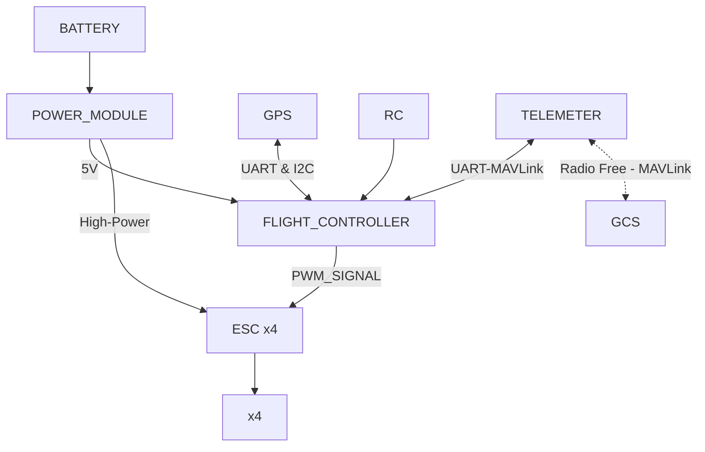
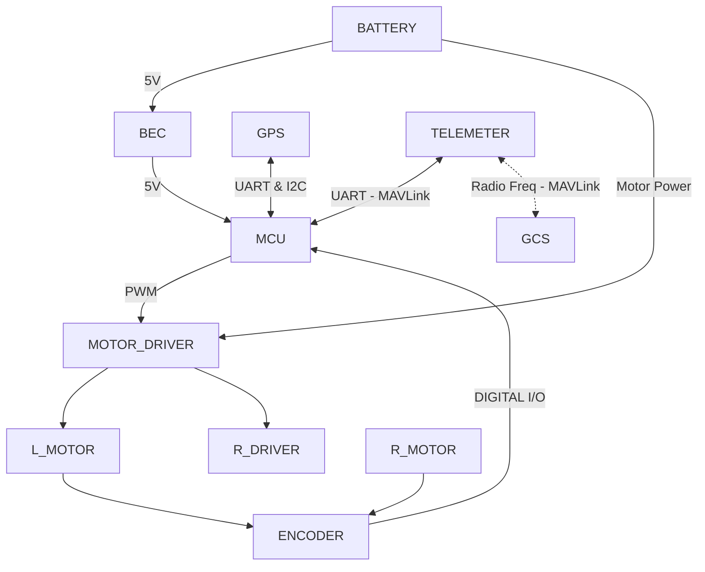

# İHA ve İKA Entegrasyonu - Heterojen Sürü Koordinasyonu

## 1. Proje Mimarisi
* '/docs': Donanım bileşen listeleri, bağlantı şemaları ve değerlendirme raporu.
* 'params': ArduCopter ve ArduRover için yapılandırılmış paramtere dosyaları.
* '/src': MAVLink protokolü üzerinden haberleşen C tabanlı koordinatör yazılımı.
* '/simulation': ArduPilot SITL simülasyon ortamı yapılandırmaları ve test notları.

## 2. Donanım Bileşenleri ve Bağlantı Şemaları
# İnsansız Hava Aracı Komponentleri:
  * Hava Gövdesi ve Yapı 
    • İşlev: Uçuş ve iniş sırasındaki tüm sistemleri bir arada tutan mekanik iskeleti oluşturur.
    • Temel Özellikler: Yüksek dayanım/ağırlık oranı, düşük titreşim iletimi ve yorulmaya karşı direnç.
    • Yaygın Malzemeler: Karbon fiber kompozitler, alüminyum alaşımlar ve özel plastikler.

  * İtki Sistemi 
    • İşlev: Hava aracını havalandırmak, dengelemek ve manevra için gerekli itki ve torku üretir.
    • Temel Bileşenler:
    -> Fırçasız DC Motorlar: Yüksek güç/ağırlı verimliliği, düşük ses seviyesi ve uzun çalışma ömrü. Yüksek KV değerine göre ağır yükler için daha yüksek tork sağlarken, düşük KV değeri daha küçük ve hızlı sistemler için uygundur.
    -> Elektronik Hız Kontrol Üniteleri (ESC): Bataryadan gelen doğru akımı, motor hızını gerçek zamanlı olarak düzenlemek üzere 3 fazlı alternatif akıma dönüştürür.
    -> Pervaneler: Kaldırma kuvvetini, seyir hızını ve aerodinamik verimliliği optimize etmek amacıyla tasarlanmıştır.

  * Güç ve Batarya Sistemi
    • İşlev: Elektrik enerjisini depolar ve araç üzerindeki tüm elektronik aksam ile motorlara dağıtır.
    • Temel Özellikler: Yüksek enerji yoğunluğu ve yüksek deşarj hızı kapasitesi.
    • Yaygın Türler: Lityum Polimer (LiPo) ve Lityum-İyon (Li-Ion) batarya paketleri; uzun süreli görev yapabilen platformlar için ise yanmalı motorlar veya hidrojen yakıt hücreleri kullanılır. Sistem, Güç Dağıtım Kartları (PDB) aracılığıyla yönetilir.

  * Uçuş Kontrol Sistemi (FCS / Aviyonik)
    • İşlev: Gerçek zamanlı dengeleme ve navigasyon yazılımlarını (PX4 veya ArduPilot gibi) çalıştıran merkezi bir "beyin" görevi görür.
    • Temel Sensörler ve Mikrodenetleyiciler:
      -> Ataletsel Ölçüm Birimi (IMU): Açısal hızları ve doğrusal ivmelenmeyi takip etmek için jiroskopları ve ivmeölçerleri birleştirir. 
      -> Barometre ve Pusula: Hava basıncı aracılığıyla irtifayı, manyetik yönelim bilgisi aracılığıyla ise yönü ölçer. 
      -> Mikrodenetleyici / İşlemci: Düşük gecikmeli döngü süreleri sağlamak amacıyla genellikle yüksek hızlı STM32 veya gelişmiş ARM işlemciler temel alınarak tasarlanmıştır.

  * Navigasyon ve Konumlandırma
    • İşlev: Gerçek zamanlı coğrafi koordinatları ve yer hızını belirler.
    • Temel Özellikler: Çoklu uydu sistemi desteği ve yüksek güncelleme hızları.
    • Yaygın Teknolojiler: GNSS/GPS modülleri; santimetre düzeyinde haritalama hassasiyeti sağlamak amacıyla RTK veya PPK yöntemleriyle desteklenir.
  
  * İletişim ve Veri Bağlantıları
    • İşlev: İnsansız hava aracını (İHA); telemetri, video aktarımı ve uzaktan komut girişi için yer kontrol istasyonuna (YKİ) veya pilota bağlar.
    • Temel Özellikler: Düşük gecikme süresi, radyo frekansı (RF) parazitine karşı direnç ve güvenli, şifreli iletim kanalları.
    • Yaygın Teknolojiler: Dijital yayılı spektrum (spread-spectrum) alıcı-vericileri, Wi-Fi veya uydu bağlantıları.

  * Yükler ve Sensörler
    • İşlev: Göreve özgü hedefin gerçekleştirilmesini sağlar.
    • Yaygın Türler: Stabilize edilmiş gimbal sistemlerine monte edilmiş RGB veya termal kameralar, LiDAR tarayıcılar ve multispektral sensörler.

* UAV - GRAPH

# İnsansız Kara Aracı Komponentleri:
  * Mobil Platform / Güç Aktarım Sistemi
    • Yapılandırma: Tekerlekli, paletli ya da bacaklı hareket sistemlerini kullanır.
    • Tahrik: Dişli kutuları ve hız kontrol üniteleriyle donatılmış elektrikli motorlar ya da içten yanmalı motorlar aracılığıyla güç alır.
    • Hareket Kabiliyeti ve Kontrol: Tekerlek hızı kontrolü, kinematik yönlendirme geri bildirimi sağlar; çamur, kayalık zemin ve eğimler üzerinde araziye uyum gösterir.

  * Sensörler ve Algılama Paketi 
    • Çevresel Sensörler: Engel tespiti ve haritalama için LiDAR/lazer tarayıcılar, stereoskopik veya monoküler kameralar ve ultrasonik/kızılötesi mesafe ölçerler.
    • Atalet ve Konumsal Sensörler: Küresel Navigasyon Uydu Sistemleri ve tekerlek optik kodlayıcıları.
    • Yük/Özel Sensörler: Çevresel monitörler veya robotik kollar ve KBRN dedektörleri gibi göreve özel yükler.

  * Bilişim ve Elektronik Mimarisi
    • Birincil ve İkincil Kartlar: Otonomi ve SLAM işlemleri için üst düzey tek kartlı bilgisayarlar ile sensör/motor arayüzü gibi düşük seviyeli işlemler için gerçek zamanlı mikrodenetleyicilerin bir arada kullanıldığı çok katmanlı işleme birimleri.
    • İletişim Modülleri: Uzaktan kontrol ve veri telemetrisi için Wi-Fi, uzun menzilli RF, hücresel bağlantılar veya Bluetooth modülleri.
    • Güvenlik Sistemleri: Anlık durum geri bildirimi sağlayan, donanım tabanlı acil durdurma devreleri.

  * Güç Alt Sistemi
    • Kaynak: Yüksek kapasiteli şarj edilebilir batarya paketleri veya hibrit/yakıtlı jeneratörler.
    • Dağıtım: Yüksek akım çeken motorları, hassas mantık ve işlem kartlarından ayırarak voltaj düşüşlerini önlemek amacıyla kullanılan izole güç hatları ve voltaj regülatörleri.

  * Yapısal ve Çevresel Koruma
    • Şasi ve Malzemeler: Belirli yük limitleri için üretilmiş hafif, yüksek mukavemetli metaller, kompozitler veya takviyeli plastikler.
    • Sızdırmazlık ve Yalıtım: Toza, su sıçramasına, aşırı sıcaklıklara ve mekanik şoka karşı koruma sağlamak için özel kauçuk contalar, sızdırmazlık elemanları, ısı yalıtımı, titreşim sönümleyici bağlantı elemanları ve EMI kalkanı.

* UGV - GRAPH

## 3. Kurulum ve Çalıştırma Adımları 
1. **Simulasyonun başlatılması:** ...
2. **Koordinatör Yazılımının Derlenmesi:** ...

## 4. Uygulanan Algoritma ve Senaryo
* **Senaryo:** İHa belirlenen alanı tarar ve tespit ettiği hedef konumu koordinatöre iletir, koordinatör bu hedefe gitme görevini İKA'ya atar.

## 5. Simülasyon Test Videosu
*(Ekran kaydı bağlantısı buraya eklenecektir.)

## 6. Referanslar ve Literatür Taraması
Projenin mimari tasarımı, simülasyon kurgusu ve heterojen koordinasyon mantığı oluşturulurken aşağıdaki akademik ve teknik kaynaklardan faydalanılmıştır:
gemini.google.com
www.mdpi.com
www.ardupilot.org/
mavlink.io
https://www.researchgate.net/figure/Structure-of-a-MAVLink-frame_fig3_339216647
[arxiv.org](https://arxiv.org/html/2412.12776v2)

