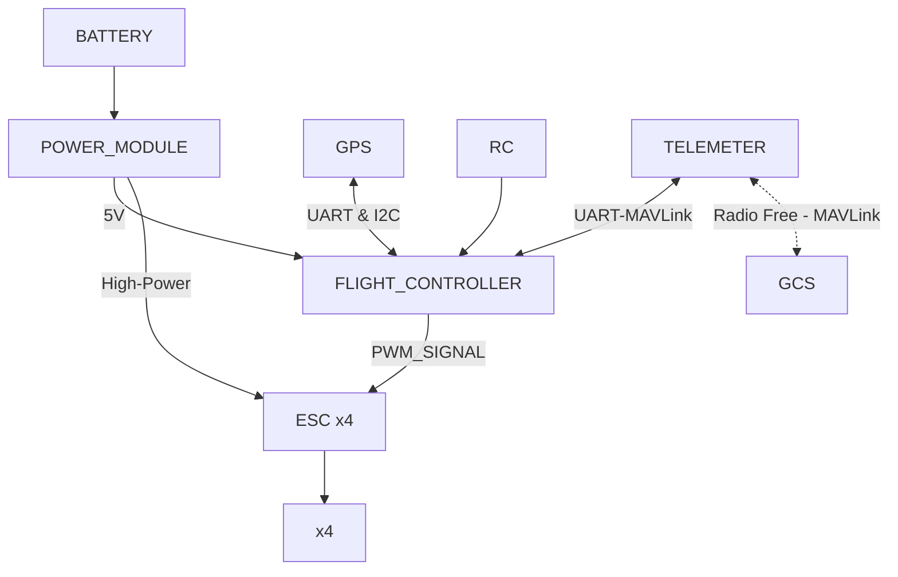
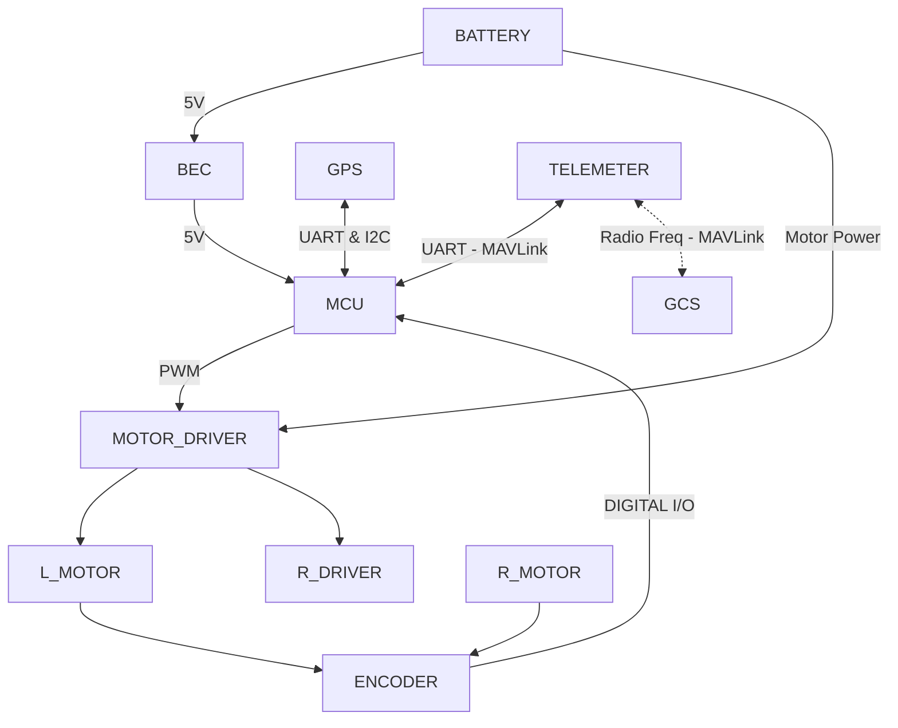

# İHA ve İKA Entegrasyonu - Heterojen Sürü Koordinasyonu

## 1. Proje Mimarisi
* '/docs': Donanım bileşen listeleri, bağlantı şemaları ve değerlendirme raporu.
* 'params': ArduCopter ve ArduRover için yapılandırılmış paramtere dosyaları.
* '/src': MAVLink protokolü üzerinden haberleşen C tabanlı koordinatör yazılımı.
* '/simulation': ArduPilot SITL simülasyon ortamı yapılandırmaları ve test notları.

## 2. Donanım Bileşenleri ve Bağlantı Şemaları
# İnsansız Hava Aracı Komponentleri:
  * Hava Gövdesi ve Yapı 
    • İşlev: Uçuş ve iniş sırasındaki tüm sistemleri bir arada tutan mekanik iskeleti oluşturur.
    • Temel Özellikler: Yüksek dayanım/ağırlık oranı, düşük titreşim iletimi ve yorulmaya karşı direnç.
    • Yaygın Malzemeler: Karbon fiber kompozitler, alüminyum alaşımlar ve özel plastikler.

  * İtki Sistemi 
    • İşlev: Hava aracını havalandırmak, dengelemek ve manevra için gerekli itki ve torku üretir.
    • Temel Bileşenler:
    -> Fırçasız DC Motorlar: Yüksek güç/ağırlı verimliliği, düşük ses seviyesi ve uzun çalışma ömrü. Yüksek KV değerine göre ağır yükler için daha yüksek tork sağlarken, düşük KV değeri daha küçük ve hızlı sistemler için uygundur.
    -> Elektronik Hız Kontrol Üniteleri (ESC): Bataryadan gelen doğru akımı, motor hızını gerçek zamanlı olarak düzenlemek üzere 3 fazlı alternatif akıma dönüştürür.
    -> Pervaneler: Kaldırma kuvvetini, seyir hızını ve aerodinamik verimliliği optimize etmek amacıyla tasarlanmıştır.

  * Güç ve Batarya Sistemi
    • İşlev: Elektrik enerjisini depolar ve araç üzerindeki tüm elektronik aksam ile motorlara dağıtır.
    • Temel Özellikler: Yüksek enerji yoğunluğu ve yüksek deşarj hızı kapasitesi.
    • Yaygın Türler: Lityum Polimer (LiPo) ve Lityum-İyon (Li-Ion) batarya paketleri; uzun süreli görev yapabilen platformlar için ise yanmalı motorlar veya hidrojen yakıt hücreleri kullanılır. Sistem, Güç Dağıtım Kartları (PDB) aracılığıyla yönetilir.

  * Uçuş Kontrol Sistemi (FCS / Aviyonik)
    • İşlev: Gerçek zamanlı dengeleme ve navigasyon yazılımlarını (PX4 veya ArduPilot gibi) çalıştıran merkezi bir "beyin" görevi görür.
    • Temel Sensörler ve Mikrodenetleyiciler:
      -> Ataletsel Ölçüm Birimi (IMU): Açısal hızları ve doğrusal ivmelenmeyi takip etmek için jiroskopları ve ivmeölçerleri birleştirir. 
      -> Barometre ve Pusula: Hava basıncı aracılığıyla irtifayı, manyetik yönelim bilgisi aracılığıyla ise yönü ölçer. 
      -> Mikrodenetleyici / İşlemci: Düşük gecikmeli döngü süreleri sağlamak amacıyla genellikle yüksek hızlı STM32 veya gelişmiş ARM işlemciler temel alınarak tasarlanmıştır.

  * Navigasyon ve Konumlandırma
    • İşlev: Gerçek zamanlı coğrafi koordinatları ve yer hızını belirler.
    • Temel Özellikler: Çoklu uydu sistemi desteği ve yüksek güncelleme hızları.
    • Yaygın Teknolojiler: GNSS/GPS modülleri; santimetre düzeyinde haritalama hassasiyeti sağlamak amacıyla RTK veya PPK yöntemleriyle desteklenir.
  
  * İletişim ve Veri Bağlantıları
    • İşlev: İnsansız hava aracını (İHA); telemetri, video aktarımı ve uzaktan komut girişi için yer kontrol istasyonuna (YKİ) veya pilota bağlar.
    • Temel Özellikler: Düşük gecikme süresi, radyo frekansı (RF) parazitine karşı direnç ve güvenli, şifreli iletim kanalları.
    • Yaygın Teknolojiler: Dijital yayılı spektrum (spread-spectrum) alıcı-vericileri, Wi-Fi veya uydu bağlantıları.

  * Yükler ve Sensörler
    • İşlev: Göreve özgü hedefin gerçekleştirilmesini sağlar.
    • Yaygın Türler: Stabilize edilmiş gimbal sistemlerine monte edilmiş RGB veya termal kameralar, LiDAR tarayıcılar ve multispektral sensörler.

* UAV - GRAPH


# İnsansız Kara Aracı Komponentleri:
  * Mobil Platform / Güç Aktarım Sistemi
    • Yapılandırma: Tekerlekli, paletli ya da bacaklı hareket sistemlerini kullanır.
    • Tahrik: Dişli kutuları ve hız kontrol üniteleriyle donatılmış elektrikli motorlar ya da içten yanmalı motorlar aracılığıyla güç alır.
    • Hareket Kabiliyeti ve Kontrol: Tekerlek hızı kontrolü, kinematik yönlendirme geri bildirimi sağlar; çamur, kayalık zemin ve eğimler üzerinde araziye uyum gösterir.

  * Sensörler ve Algılama Paketi 
    • Çevresel Sensörler: Engel tespiti ve haritalama için LiDAR/lazer tarayıcılar, stereoskopik veya monoküler kameralar ve ultrasonik/kızılötesi mesafe ölçerler.
    • Atalet ve Konumsal Sensörler: Küresel Navigasyon Uydu Sistemleri ve tekerlek optik kodlayıcıları.
    • Yük/Özel Sensörler: Çevresel monitörler veya robotik kollar ve KBRN dedektörleri gibi göreve özel yükler.

  * Bilişim ve Elektronik Mimarisi
    • Birincil ve İkincil Kartlar: Otonomi ve SLAM işlemleri için üst düzey tek kartlı bilgisayarlar ile sensör/motor arayüzü gibi düşük seviyeli işlemler için gerçek zamanlı mikrodenetleyicilerin bir arada kullanıldığı çok katmanlı işleme birimleri.
    • İletişim Modülleri: Uzaktan kontrol ve veri telemetrisi için Wi-Fi, uzun menzilli RF, hücresel bağlantılar veya Bluetooth modülleri.
    • Güvenlik Sistemleri: Anlık durum geri bildirimi sağlayan, donanım tabanlı acil durdurma devreleri.

  * Güç Alt Sistemi
    • Kaynak: Yüksek kapasiteli şarj edilebilir batarya paketleri veya hibrit/yakıtlı jeneratörler.
    • Dağıtım: Yüksek akım çeken motorları, hassas mantık ve işlem kartlarından ayırarak voltaj düşüşlerini önlemek amacıyla kullanılan izole güç hatları ve voltaj regülatörleri.

  * Yapısal ve Çevresel Koruma
    • Şasi ve Malzemeler: Belirli yük limitleri için üretilmiş hafif, yüksek mukavemetli metaller, kompozitler veya takviyeli plastikler.
    • Sızdırmazlık ve Yalıtım: Toza, su sıçramasına, aşırı sıcaklıklara ve mekanik şoka karşı koruma sağlamak için özel kauçuk contalar, sızdırmazlık elemanları, ısı yalıtımı, titreşim sönümleyici bağlantı elemanları ve EMI kalkanı.

* UGV - GRAPH


## 3. Kurulum ve Çalıştırma Adımları 
### Gereksinimler
* **İşletim Sistemi:** Linux (Ubuntu 22.04+), macOS veya Windows (WSL2)
* **Derleyici & Araçlar:** `gcc` veya `clang`, `make`
* **Simülasyon & Yer Kontrol İstasyonu:** Docker, QGroundControl (veya Mission Planner)

**Virtual Firmwares:**
* İHA (ArduCopter): [https://firmware.ardupilot.org/Copter/stable/SITL_x86_64_linux_gnu/arducopter](https://firmware.ardupilot.org/Copter/stable/SITL_x86_64_linux_gnu/arducopter)
* İKA (ArduRover): [https://firmware.ardupilot.org/Rover/stable/SITL_x86_64_linux_gnu/ardurover](https://firmware.ardupilot.org/Rover/stable/SITL_x86_64_linux_gnu/ardurover)

---

1. ### 1. Simülasyonun Başlatılması (ArduPilot SITL)
İHA ve İKA örneklerinin birbirinden bağımsız MAVLink kimlikleri (`SYSID`) ve TCP portları üzerinden haberleşebilmesi için iki ayrı terminalde aşağıdaki Docker konteynerleri başlatılır:

* **Terminal 1 — UAV (ArduCopter | SYSID: 1 | Port: 5762):**
```bash
docker run -it --rm --name uav_sitl \
  -p 5760:5760 -p 5762:5762 \
  --platform linux/amd64 ubuntu:22.04 bash -c "
  apt-get update && apt-get install -y curl && \
  curl -L [https://firmware.ardupilot.org/Copter/stable/SITL_x86_64_linux_gnu/arducopter](https://firmware.ardupilot.org/Copter/stable/SITL_x86_64_linux_gnu/arducopter) -o /usr/local/bin/arducopter && \
  chmod +x /usr/local/bin/arducopter && \
  /usr/local/bin/arducopter -S -I0 --home 42.3900,-71.1476,14,0 --model + --sysid 1"
```

* **Terminal 2 - UGV (ArduRover | STSID: 2 | Port: 5772)**
```bash
docker run -it --rm --name ugv_sitl \
  -p 5770:5770 -p 5772:5772 \
  --platform linux/amd64 ubuntu:22.04 bash -c "
  apt-get update && apt-get install -y curl && \
  curl -L [https://firmware.ardupilot.org/Rover/stable/SITL_x86_64_linux_gnu/ardurover](https://firmware.ardupilot.org/Rover/stable/SITL_x86_64_linux_gnu/ardurover) -o /usr/local/bin/ardurover && \
  chmod +x /usr/local/bin/ardurover && \
  /usr/local/bin/ardurover -S -I1 --home 42.3902,-71.1476,14,0 --model rover --sysid 2"
```

2. **Koordinatör Yazılımının Derlenmesi ve Çalıştırılması:**
   Simülasyon ortamında her iki aracın da GPS kilidi aldığı (`EKF3 IMU0 is using GPS`) doğrulandıktan sonra **üçüncü bir terminal** açılarak proje ana dizinine geçilir, `Makefile` üzerinden yazılım derlenir ve başlatılır:

```bash
# Proje ana dizinine girin
cd MAVLink_System

# Linux ve macOS ortamlarını Makefile ile derleyin
make clean && make

# Heterojen koordinasyon yazılımını başlatın
./mission_app
```

## 4. Uygulanan Algoritma ve Senaryo

### 4.1 Alan Tarama Algoritması: Boustrophedon (Lawnmower)
Bu projede İHA'nın belirlenen görev sahasını eksiksiz ve enerji verimli şekilde taraması için **Boustrophedon (Biçerdöver) Kapsama Yolu Planlama** algoritması uygulanmıştır.

* **Çalışma Prensibi:**
  1. İHA'nın GPS kilidi aldığı başlangıç konumu merkez alınarak dikdörtgen bir tarama bölgesi tanımlanır.
  2. Belirlenen tarama aralığına (*step size*) göre alan paralel şeritlere bölünür.
  3. İHA her şerit sonunda başlangıç noktasına geri dönmek yerine ardışık şeritleri zıt yönlerde (ileri–geri zigzag) takip edecek şekilde ara noktalar (*waypoints*) üretilir.
  4. Yerel metre cinsinden hesaplanan $(x, y)$ ofsetleri, Dünya yarıçapı ve enlem kosinüsü düzeltmesi kullanılarak gerçek GPS koordinatlarına (`latitude`, `longitude`) dönüştürülür.

* **Seçim Gerekçesi:**
  * **Tam Kapsama Garantisi:** Açık ve dışbükey alanlarda kör nokta bırakmadan %100 görsel/sensör kapsaması sağlar.
  * **Enerji ve Zaman Verimliliği:** Dönüş manevralarını ve boşta kat edilen mesafeyi en aza indirerek batarya ömrü kısıtlı olan İHA'ların görev süresini optimize eder.
  * **Düşük Hesaplama Maliyeti:** Gömülü C ortamında dinamik bellek karmaşıklığı yaratmadan gerçek zamanlı ve deterministik olarak rota üretebilir.

---

### 4.2 Uçtan Uca Görev Senaryosu ve Durum Makinesi
Heterojen sürü koordinasyonu, araç tipinden bağımsız çalışan polimorfik `Vehicle_t` (`VTable`) arayüzü üzerinde 5 aşamalı bir **Sonlu Durum Makinesi (Finite State Machine)** ile yürütülür:

1. **`STATE_INIT` (Başlatma ve Rota Üretimi):**
   * İHA (`SYSID: 1`) ve İKA (`SYSID: 2`) ile TCP/MAVLink bağlantıları kurulur ve 10 Hz telemetri akışı başlatılır.
   * Her iki araçtan ilk geçerli GPS verisi alındığında Boustrophedon planlayıcı çalıştırılarak tarama noktaları oluşturulur.
2. **`STATE_TAKEOFF` (Kalkış ve Hazırlık):**
   * İHA `GUIDED` moda alınır, motorları `ARM` edilir ve `MAV_CMD_NAV_TAKEOFF` komutu ile hedef tarama irtifasına (15 m) yükseltilir.
   * Eş zamanlı olarak İKA `GUIDED` moda alınıp `ARM` edilerek sürüşe hazır bekletilir.
3. **`STATE_SCAN` (Otonom Alan Taraması):**
   * İHA üretilen tarama noktalarını sırayla takip eder; her noktaya varış **Haversine** küresel mesafe formülü ile denetlenir.
   * Tarama sırasında belirlenen sanal hedef bölgesine girildiğinde hedef tespiti tetiklenir.
4. **`STATE_UGV_ASSIGN` (Eş Zamanlı Görev Atama):**
   * Tespit edilen hedefin GPS koordinatları koordinatöre iletilir ve koordinatör bu noktaya gitme görevini İKA'ya atar.
   * İKA hedefe doğru ilerlerken İHA alan tarama görevine kesintisiz devam eder.
5. **`STATE_MISSION_COMPLETE` (Görev Tamamlama ve Güvenli Sonlandırma):**
   * İKA hedef konuma belirlenen varış toleransı içerisine girdiğinde `HOLD` moduna geçerek durur.
   * İHA güvenli iniş (`LAND`) moduna alınır ve görev başarıyla sonlandırılır.

## 5. Simülasyon Test Videosu

* Uçtan uca senaryo akışını (İHA kalkışı, Boustrophedon alan taraması, hedef tespiti, İKA görev ataması ve hedefe varış) içeren test kaydına aşağıdaki YouTube bağlantısından ulaşabilirsiniz:
* [İHA–İKA Heterojen Sürü Koordinasyonu Test Kaydı](https://youtu.be/VIDEO_ID_BURAYA)

## 6. Referanslar ve Literatür Taraması
**Akademik Kaynakça ve Literatür**
* gemini.google.com
* www.mdpi.com
* www.ardupilot.org/
* mavlink.io
* https://www.researchgate.net/figure/Structure-of-a-MAVLink-frame_fig3_339216647
* [arxiv.org](https://arxiv.org/html/2412.12776v2)

